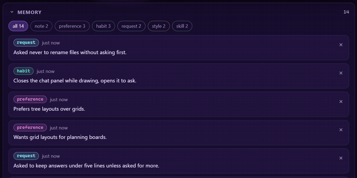
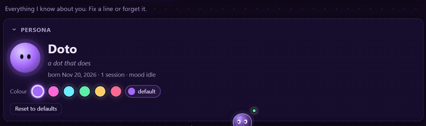

<p align="center"></p>

<p align="center">
  <a href="https://github.com/offensiveadhd/lets-unique-den/actions/workflows/validate.yml"></a>
  
  
  
  <a href="LICENSE"></a>
</p>

<p align="center"><b>Doto's home.</b><br>The second default <a href="https://github.com/offensiveadhd/lets">lets</a> unique: see everything the companion learned about you, and edit or forget any of it by pointing. Nothing is inferred silently in lets, and den is where you can check that.</p>

<p align="center">
  <a href="#see-it-run">See it run</a> ·
  <a href="#install">Install</a> ·
  <a href="#what-you-can-do">What you can do</a> ·
  <a href="#how-edits-work">How edits work</a> ·
  <a href="#how-claude-drives-it">How Claude drives it</a> ·
  <a href="#layout">Layout</a> ·
  <a href="#develop">Develop</a>
</p>

## See it run

<p align="center">
  <a href="assets/demo.mp4"></a>
</p>

One real take of the den window on a real lets host, recorded in a headless browser. The profile it shows
belongs to an invented developer and was put there through the engine's own `entity` tool, the way Claude
writes it. The hand drags, clicks and types through the browser's own input. Claude's side (applying each
edit with `entity`, the `den.refresh` that confirms it, the answer, Doto's lines) is sent through the
engine's own tools by a script written ahead, following [GUIDE.md](GUIDE.md), because a recording cannot
wait on a live model. Select the picture for the [full take](assets/demo.mp4). How it was recorded is in
[lets/promo](https://github.com/offensiveadhd/lets/tree/main/promo).

## Install

It comes with `lets` 0.6.0. The engine installs `den` into `~/.lets/uniques/den` the first time it runs, because it is listed in the engine's `defaults.json`. Then:

```
/lets:lets den          # or /lets den with the alias
```

Manual: `/lets store den` (inspect → confirm), or clone this repo into `~/.lets/uniques/den`, or set `LETS_UNIQUES_DIRS=<parent folder>` while developing. den needs the engine's `GET /lip/entity` (lets ≥ 0.6.0). On an older engine it says so and shows only the persona.

## What you can do

| card | what it shows and what you can do |
|---|---|
| **Persona** | Click his name or tagline to rename him (Enter saves, Esc cancels). Pick one of six colours or the default. *Reset to defaults* asks first. |
| **Traits** | Six sliders: speed, distance, chatty, playful, formality, curiosity. Each has its two ends spelled out (calm ↔ snappy, quiet ↔ talks…) and a tick at the default. |
| **Likes, Dislikes** | Chips with ×, and an input to add one. |
| **Nicknames** | What you call things → what you mean. Edit a value inline, × to forget. |
| **Memory** | Every line he wrote about you, newest first, with its kind and date. Filter by kind, × to forget a line. |
| **Special skills** | The playbooks he taught himself: triggers, confidence, uses, the full text. Thumbs up or down, or forget one. |
| **Secret moves** | Seven dots. The ones you found are lit, and the rest stay a mystery. |
| **Profile** | How you move: pace, clicks per minute, dwell, idle, menu summons / picks / dismisses, sessions, last seen, favourite screen regions. |

### How edits work

<p align="center">
  
</p>

- Every edit is instant and marked **pending** until Claude applies it with the `entity` tool and refreshes the den.
- If Claude is not listening right then, den says so, and the edit is applied with your next message in Claude Code.
- **Ctrl+Z** undoes your last edit; Claude gets the inverse and treats it as a no.

<p align="center">
  
</p>

### The rest of the page

- **Ask**, or Doto's click menu ("What do you know about me?", "Why this?", "Forget this"), sends a question about the row you are pointing at. Claude answers in the chat panel and highlights what it cites.
- **Send to Claude** hands everything over for a review. The window closes and Claude answers in Claude Code: a short summary of what Doto knows, stale or contradictory lines, and a cleanup list you can say yes to. Say *continue* to bring den back with the live state.
- Keyboard: Tab reaches every row. Delete on a focused × forgets, 1–9 jump to a card, `?` lists the shortcuts, and Esc closes things.

## How Claude drives it

<p align="center"></p>

Events (up): `den.persona.set`, `den.persona.reset`, `den.like.add|forget`, `den.dislike.add|forget`, `den.nickname.set|forget`, `den.memory.forget`, `den.skill.forget`, `den.skill.rate`, `den.ask`, `den.export`, `den.snapshot`.
Commands (down): `den.load`, `den.refresh`, `den.highlight`, `den.focus`, `den.snapshot`.

The manifest's `session` block (`export: den.export`, `snapshot: den.snapshot`, `restore: den.load`) lets the engine save and resume a review.

- [GUIDE.md](GUIDE.md) is what Claude reads when it opens den: which `entity` action applies each event, the commands, the etiquette.
- [CONTRACT.md](CONTRACT.md) is the behaviour spec.
- `schemas/` holds JSON Schemas for the entity payload and the main messages.

<details>
<summary>The take above, as the messages that crossed</summary>

| Who | Message | What you see |
|---|---|---|
| you | `den.persona.set` with the traits | the chatty slider dragged down; the row is marked pending |
| Claude | the `entity` tool, action `set`, then `den.refresh` | the pending mark clears, and Doto says "Quieter. Got it." |
| you | `den.memory.forget` | the × on a stale memory line; the row is marked pending |
| Claude | the `entity` tool, action `unlearn`, then `den.refresh` | the line is gone, and Doto counts what is left |
| you | `den.ask` | "What do you know about me?" from Doto's menu |
| Claude | a chat answer, `den.highlight` on each line it cites | counts first, then what matters most, with the cited memory lines lit |
| you | `den.persona.set` with the name | his name clicked and retyped; the name is marked pending |
| Claude | the `entity` tool, action `set`, then `den.refresh` | the new name stands, and he says it |

</details>

## Layout

```
unique.json    LIP manifest (name, entry, domains, events, commands, session, permissions)
GUIDE.md       instructions for Claude
CONTRACT.md    behaviour spec
icon.svg
schemas/       entity.json (the GET /lip/entity payload), persona.set, ask, load, highlight; unique.schema.json (vendored)
ui/            index.html, den.js (the home), style.css
scripts/       validate.mjs — manifest + schema check (zero dependencies)
assets/        what this README shows: the banner, the recordings, the diagram
```

The UI imports the engine's SDK at runtime (`/sdk/lets-client.js`, `/sdk/lets-shell.js`). It has no build step and no dependencies, and it stores nothing but two view preferences (collapsed cards, memory filter) in `localStorage`.

## Develop

```bash
# from a lets checkout; the registry looks for <dir>/den/unique.json,
# so point it at the PARENT of a folder named "den" (symlink or junction this repo there)
LETS_UNIQUES_DIRS=/path/to/parent node engine/bin/lets.mjs serve --open den --verbose

node engine/bin/lets.mjs send den.highlight '{"section":"likes","ttl":3000}'   # drive it from the CLI
node engine/bin/lets.mjs events                                                # drain what den emitted
```

Validate with `node scripts/validate.mjs` here, or `node engine/bin/lets.mjs validate <this folder>` from the engine.

## License

MIT © offensiveadhd
